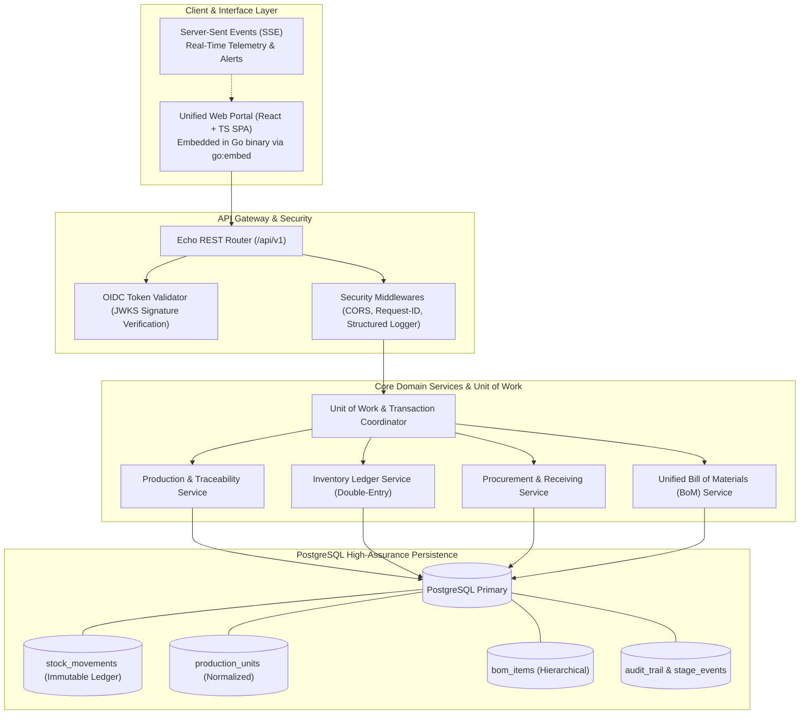

# Masar (مسار) Architecture & Engineering Roadmap

**System:** Masar (مسار) Production Tracebility Platform  
**Target:** Industrial Manufacturing Flow  
**Role:** Principal Software Architect  
**Status:** Approved for Implementation  

---

## 1. Executive Summary

Masar (مسار) serves as the manufacturing execution and traceability platform for high-assurance hardware, including Quantum Key Distribution (QKD) optical systems. The platform replaces manual spreadsheets with an automated single source of truth across product baselines, serialization, optical characterization, cleanroom inventory, rework, deviations, and procurement.

This document details the architectural findings from the codebase review and establishes a phased engineering roadmap to transition the platform into an enterprise-grade, high-reliability manufacturing and inventory execution engine aligned with the **TII-QKD** manufacturing flow.

---

## 2. Target Architectural Blueprint



---

## 3. Key Architectural Pillars

### 3.1. Immutable Inventory Ledger (Double-Entry Stock Control)
* **Problem:** Stock items currently undergo in-place mutable updates (`quantity_on_hand += delta`) without an audit trail, leading to zero historical visibility into who adjusted stock, which work order consumed parts, or which PO received them.
* **Target Design:** Implement an append-only `stock_movements` ledger recording all material transactions (`PO_RECEIPT`, `MFG_CONSUMPTION`, `REWORK_REPLACEMENT`, `SCRAP`, `CYCLE_COUNT_ADJUSTMENT`). `quantity_on_hand` becomes a verified balance enforced by atomic database operations.

### 3.2. Closed-Loop Manufacturing & Traceability Tree
* **Problem:** `QKDModule` + `BoMItem` and `ProductionUnitRecord` exist in isolated silos. Serialized components installed on units are stored in unindexed JSONB and do not check cleanroom stock availability.
* **Target Design:**
  * Unify the Product Master / Engineering BoM (blueprint) with Unit Instances (as-built physical hardware).
  * Automatically validate installed component serial numbers against available stock, deduct inventory atomically, and link parent-child genealogy.
  * Enable instantaneous backward and forward lot traceability (e.g., recall query for any defective laser diode lot).

### 3.3. ACID Transactions & Concurrency Safety
* **Problem:** Multi-entity operations like `PairUnits` (linking Alice and Bob) execute two separate database updates without a transaction boundary; failure of the second leaves the system in an inconsistent state. Concurrency lack optimistic locking.
* **Target Design:**
  * Introduce a `TransactionManager` / Unit-of-Work pattern (`WithTx`) for all multi-table mutations.
  * Implement Optimistic Concurrency Control (OCC) using row version numbers (`version INT`) to eliminate lost updates.
  * Replace shallow copies in memory repositories with thread-safe deep copies.

### 3.4. Database Normalization & High-Performance SQL Aggregations
* **Problem:** Sub-entities (`rework_history`, `deviations`, `test_executions`, `inspection_records`) are packed into JSONB arrays. Dashboard and card endpoints execute full table scans and unmarshal all records in Go memory to count totals.
* **Target Design:**
  * Normalize 1-to-N relationships into relational tables (`unit_rework_records`, `unit_deviations`, `unit_test_executions`) with foreign keys and composite indexes.
  * Push KPI calculations to PostgreSQL using `COUNT(*) FILTER (...)` and SQL aggregation views, reducing query latency from ~300ms to <2ms.

### 3.5. Security & Identity Hardening
* **Problem:** OIDC token validation decodes base64 JWT payloads without verifying cryptographic signatures. Development bypass automatically grants admin access if tokens are blank.
* **Target Design:**
  * Integrate cryptographic signature verification (RS256/ES256) via JWKS key sets retrieved from the identity provider.
  * Restrict development bypass to explicit headers, disable completely when running in staging or production.

### 3.6. Frontend Modernization & Real-Time Telemetry
* **Problem:** Dual frontend maintenance debt (6 static HTML files with copied markup vs. an incomplete React/TypeScript app in `frontend/`).
* **Target Design:**
  * Complete the modern React 18 + TypeScript SPA with Vite.
  * Embed compiled frontend assets directly into the Go executable using `//go:embed` for a single zero-dependency binary suitable for air-gapped cleanroom environments.
  * Implement Server-Sent Events (SSE) for real-time stock alert banners and optical test result streaming.

---

## 4. Phased Modernization Roadmap

```
Phase 0: Immediate Fixes & Safety Gates (P0)
   ├── Fix API error mapping (HTTP 404/409/422 status codes)
   ├── Harden OIDC Dev Bypass against anonymous escalation
   └── Memory repository deep-copy fixes
Phase 1: ACID Transactions & Concurrency Control (P0)
   ├── TransactionManager / Unit-of-Work (WithTx) implementation
   ├── Atomic Alice-Bob pairing and unpairing
   └── Optimistic Concurrency Control (OCC) versioning
Phase 2: Immutable Inventory Ledger & Material Flow (P1)
   ├── stock_movements ledger table & repository
   ├── Closed-loop material allocation for production units
   └── Purchase Order Goods Receipt workflow (3-Way Matching)
Phase 3: Relational Normalization & SQL Aggregations (P1)
   ├── Schema migration: normalize rework, deviations, tests, inspections
   ├── Database-level KPI aggregations (eliminate in-memory scans)
   └── Composite indexing for serial, lot, and status queries
Phase 4: Frontend Consolidation & Real-Time Telemetry (P2)
   ├── Complete React + Vite SPA integration
   ├── Single-binary deployment via go:embed
   └── Server-Sent Events (SSE) for real-time dashboard updates
```

---

### Phase 0: Immediate Fixes & Safety Gates
* **Objective:** Remove security vulnerabilities and correct HTTP response semantics.
* **Deliverables:**
  1. Map `domain.ErrUnitNotFound`, `domain.ErrStockItemNotFound`, `domain.ErrPONotFound` to HTTP 404 in `RespondError`.
  2. Map `domain.ErrUnitSerialDuplicate` to HTTP 409 Conflict.
  3. Require explicit non-empty tokens for dev bypass mode; reject blank requests with HTTP 401.
  4. Fix slice shallow copying in `internal/repository/memory/stock_repo.go`.

### Phase 1: ACID Transactions & Concurrency Control
* **Objective:** Guarantee data consistency across multi-entity operations.
* **Deliverables:**
  1. Define `TransactionManager` interface and implement PostgreSQL transaction lifecycle (`pgx` transaction management).
  2. Refactor `PairUnits` and `UnpairUnit` to execute inside a single atomic transaction.
  3. Add `version INT DEFAULT 1` to `production_units` and `stock_items` for optimistic locking.

### Phase 2: Immutable Inventory Ledger & Material Flow
* **Objective:** Implement complete inventory traceability compliant with industrial standards.
* **Deliverables:**
  1. Database migration: `stock_movements` table.
  2. `StockMovementRepository` and service methods (`ReceiveGoods`, `IssueComponent`, `ScrapStock`, `AdjustStock`).
  3. PO Receiving endpoint: `POST /api/v1/procurement/orders/:id/receive` to transition PO items into inventory with lot tracking.
  4. Component installation validation: verify serial number existence in stock before attaching to a unit.

### Phase 3: Relational Normalization & SQL Aggregations
* **Objective:** Eliminate TOAST bloat, ensure concurrent record creation, and achieve sub-millisecond dashboard queries.
* **Deliverables:**
  1. Database migration: normalize `unit_rework_records`, `unit_deviations`, `unit_test_executions`, `unit_inspection_records`.
  2. Rewrite `GetProductionStatusCard` and `GetDashboardCard` to use PostgreSQL aggregate queries (`COUNT(*) FILTER (...)`).
  3. Add composite indexes on `(serial_number)`, `(lot_number)`, `(system_set_id)`, `(release_status)`.

### Phase 4: Frontend Consolidation & Real-Time Telemetry
* **Objective:** Unify user interface into a single embedded web application with real-time updates and notifications.
* **Deliverables:**
  1. Provide `vite.config.ts` and `index.html` in `frontend/`.
  2. Build and embed SPA assets into Go binary using `embed.FS`.
  3. Create Server-Sent Events (SSE) endpoint `/api/v1/events/stream` for cleanroom status broadcasting.
  4. **Automated Transactional Email & Outbound Notification Service:** Currently, one-time invitation passwords (OTPs) for Production Unit Admins and line operators are generated securely in-system and conveyed directly. In this phase, integrate an automated outbound email service (SMTP / SendGrid / AWS SES) to dispatch invitation tokens, activation magic links, and critical deviation alerts directly to user email addresses.

