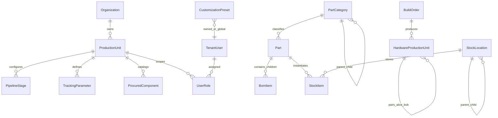

# Masar (مسار) - System Design Document

**Role:** Principal Software Architect  
**System:** Masar Industrial Hardware Traceability & Manufacturing Execution Platform  
**Architecture Paradigm:** Django 5.2 + Django REST Framework + InvenTree-Aligned Modular Domain Engine  
**Storage Engine:** Embedded SQLite (`data/masar.db`) · Zero External Daemon Dependency  
**Current Release:** `v2.0.0-django`

---

## 1. Executive Architecture Summary

**Masar** (مسار, Arabic for *Path* or *Trajectory*) is an industrial hardware traceability and manufacturing execution system (MES) designed specifically for high-assurance hardware manufacturing, quantum communication systems (Quantum Key Distribution - QKD), cleanroom operations, and discrete assembly lines.

Inspired by the open-source **InvenTree** inventory architecture, Masar unifies:
1. **Multi-level Part & Engineering BoM Catalogs**: Hierarchical categories, engineering parameters, and cryptographic component tracking.
2. **Cleanroom Stock & Hierarchical Storage**: Bin/bay/vault locations, serialized inventory, batch/lot tracking, and automated reorder alerts.
3. **Hardware Lifecycle Traceability**: Unit-level tracking for Quantum Sender (Alice) and Receiver (Bob) modules, product baseline enforcement, system pairing, optical Factory Acceptance Test (FAT) metrics, rework loops, and deviation management.
4. **3-Tier Multi-Tenant Governance**: Enterprise Server Super Admins, Facility/Production Unit Admins, Line Engineers, QA Inspectors, and Cleanroom Operators.
5. **Runtime Workspace Customization Engine**: Dynamic pipeline stage reconfiguration, custom tracking parameter definitions, user roles, and layout preset save/load/export/import.

---

## 2. High-Level System Architecture

```mermaid
graph TB
    subgraph ClientLayer ["Client & Interface Layer (InvenTree-Style Web Portal)"]
        UI_Hub["Main Hub & Dashboard (index.html, dashboard.html)"]
        UI_Parts["Parts & BoM Explorer (parts.html)"]
        UI_Stock["Cleanroom Stock & Locations (stock.html)"]
        UI_Prod["Production & Pairing Console (production.html)"]
        UI_Pipeline["Traceability Chain & Stages (pipeline.html, stage.html)"]
        UI_Build["Build & Sub-Assemblies (build.html)"]
        UI_Admin["Server Admin Governance Console (admin_portal.js)"]
        UI_Custom["Workspace Customizer Modal & Settings (layout.js, settings.html)"]
    end

    subgraph SecurityGateway ["Security & Authentication Middleware"]
        AuthMW["MasarAuthMiddleware (masar_backend/middleware.py)"]
        JWT_Val["JWT / Bearer Token Validator"]
        Bypass_Val["Dev Bypass Header (X-Bypass-Token)"]
        Bcrypt_Auth["Bcrypt Password Hasher & Verify"]
    end

    subgraph CoreDomainServices ["Django Core Domain Applications (/api/v1/)"]
        App_Identity["identity: Multi-Tenant Governance, Stages, Params, Procured Catalog"]
        App_Part["part: InvenTree Parts, Categories, BoM Hierarchy, Parameters"]
        App_Stock["stock: Storage Locations, StockItems, Serial Tracking, Audit Logs"]
        App_Prod["production: BuildOrders, Hardware Units (Alice-Bob), Rework, Tests"]
        App_Proc["procurement: Companies (Suppliers), PurchaseOrders, Line Receipts"]
        App_Cards["cards: KPI Aggregators (Dashboard, Production, Stock, Procurement)"]
        App_Custom["customization: Presets, Baselines, Layout Save/Load/Export/Import"]
    end

    subgraph PersistenceLayer ["Embedded High-Assurance Persistence"]
        SQLite[("Embedded SQLite Engine (data/masar.db)")]
        Table_Admins[("server_admins & users & user_roles")]
        Table_PUs[("organizations & org_production_units")]
        Table_Stages[("pu_pipeline_stages & pu_tracking_parameters")]
        Table_Hardware[("hardware_production_units & build_orders")]
        Table_Inventory[("parts, bom_items, stock_items, stock_locations")]
        Table_Custom[("customization_presets & portal_baselines")]
    end

    ClientLayer --> SecurityGateway
    SecurityGateway --> CoreDomainServices
    CoreDomainServices --> PersistenceLayer
```

---

## 3. Component & Application Decomposition

The backend is structured into 7 decoupled Django applications registered in `masar_backend/settings.py`:

| Application | Primary Responsibility | Key Models | Key Endpoints |
| :--- | :--- | :--- | :--- |
| **`identity`** | Multi-tenant organizational hierarchy, 3-tier user governance, authentication, pipeline stages, custom parameters, and procured catalog. | `ServerAdmin`, `Organization`, `ProductionUnit`, `TenantUser`, `UserRole`, `PipelineStage`, `TrackingParameter`, `ProcuredComponent`, `StageFinishedProduct` | `/api/v1/identity/login`, `/api/v1/auth/production-units`, `/api/v1/auth/production-units/{pu_id}/stages`, `/api/v1/auth/production-units/{pu_id}/parameters` |
| **`part`** | InvenTree-aligned catalog for discrete components, sub-assemblies, engineering BoM tree, and technical parameters. | `PartCategory`, `Part`, `BomItem`, `PartParameter` | `/api/v1/parts`, `/api/v1/parts/categories`, `/api/v1/parts/{id}/bom` |
| **`stock`** | Physical inventory management, hierarchical cleanroom storage locations, serialized tracking, and movement logs. | `StockLocation`, `StockItem`, `StockTracking` | `/api/v1/stock/items`, `/api/v1/stock/locations`, `/api/v1/stock/items/{id}/category` |
| **`production`** | Hardware execution register, Alice/Bob module serialization, Alice-Bob pairing, rework logs, deviations, and FAT optical tests. | `ProductionUnit`, `BuildOrder` | `/api/v1/production/units`, `/api/v1/production/pair`, `/api/v1/production/units/{id}/rework`, `/api/v1/production/build-orders` |
| **`procurement`** | Supplier directory, manufacturer tracking, purchase orders (PO), and incoming inventory fulfillment. | `Company`, `PurchaseOrder` | `/api/v1/procurement/orders`, `/api/v1/procurement/suppliers` |
| **`customization`** | Workspace personalization engine, layout profiles, active themes, engineering baselines, and JSON export/import. | `CustomizationPreset`, `PortalBaseline`, `InvenTreeSetting` | `/api/v1/customization/presets`, `/api/v1/customization/presets/{id}/apply`, `/api/v1/customization/export`, `/api/v1/customization/import`, `/api/v1/settings` |
| **`cards`** | Optimized JSON summary cards for high-speed dashboard telemetry, KPI aggregation, and low-latency widget rendering. | Aggregates across `production`, `stock`, `procurement` | `/api/v1/cards/dashboard`, `/api/v1/cards/production-status`, `/api/v1/cards/stock`, `/api/v1/cards/procurement`, `/api/v1/cards/settings` |

---

## 4. Domain Model & Data Architecture

### 4.1. Identity & Governance Domain
- **`ServerAdmin`**: Top-level platform super administrator with global authority across all organizations and production facilities. Authenticates via bcrypt hash.
- **`Organization`**: Multi-tenant enterprise entity (e.g., Technology Innovation Institute - TII).
- **`ProductionUnit`**: Dedicated cleanroom facility, manufacturing plant, or assembly line (e.g., `PU_QKD`).
- **`TenantUser` & `UserRole`**: Staff accounts bound to specific production units with role scopes (`PU_ADMIN`, `LINE_ENGINEER`, `QA_INSPECTOR`, `CLEANROOM_OPERATOR`, or custom roles).

### 4.2. InvenTree Part & Stock Domain
- **`Part`**: Abstract hardware item with Internal Part Number (IPN), revision (`A`, `B`, `C`), assembly flag (`is_assembly`), salable flag, and minimum stock threshold.
- **`BomItem`**: Hierarchical Bill of Materials link connecting parent assemblies to child components with item code, quantity, reference designator, critical-path flag, and SHA-256 checksum.
- **`StockLocation`**: Cleanroom tree structure (e.g., `Main Cleanroom / Bay A / ESD Cabinet 04`).
- **`StockItem`**: Physical on-hand inventory with batch/lot tracking, serialized unit arrays (`serial_numbers`), allocated count, and low-stock reorder points.

### 4.3. High-Assurance Traceability Domain
- **`HardwareProductionUnit`**: Unit-level digital passport for Quantum Communication modules:
  - Unit Type: `SENDER_ALICE` or `RECEIVER_BOB`.
  - Cryptographic Pairing: Links Alice and Bob units into a synchronized quantum optical system (`system_set_id`, `paired_peer_serial`).
  - Traceability History: Normalized JSONB logs for deviations, rework tickets, and optical test characterization (visibility, insertion loss, extinction ratio).
  - Release State Machine: `IN_ASSEMBLY` $\rightarrow$ `TEST_PASSED` / `QUARANTINED` $\rightarrow$ `RELEASED`.

---

## 5. Security & Authentication Architecture

Masar implements an enterprise dual-mode security pipeline via `MasarAuthMiddleware`:

1. **Authentication Vectors**:
   - **Bcrypt Password Authentication**: Server admins and tenant users login via `POST /api/v1/identity/login`, returning an `adm_` or `usr_` session token persisted in `api_tokens`.
   - **OIDC Bearer Tokens**: Standard `Authorization: Bearer <token>` RFC 6750 header validation.
   - **Developer Bypass Token**: Fast local integration testing via `X-Bypass-Token: masar-dev-bypass-secret-token-2026`.
2. **Access Control Tiers**:
   - **Tier 1 (Server Super Admin)**: Can create/delete facilities, manage server settings, and access the master control plane.
   - **Tier 2 (Production Unit Admin)**: Manages cleanroom staff, invites users with OTP, configures pipeline stages, and designs sub-assembly workflows.
   - **Tier 3 (Operational Engineers & QA)**: Executes work orders, logs rework, conducts optical characterization, and records inspection parameters.

---

## 6. Workspace Customization Engine

The customization engine operates at both backend API and client UI levels:

1. **Preset State Model (`CustomizationPreset`)**:
   - Encapsulates `visible_cards`, `card_order`, `pinned_sidebar_links`, `active_theme`, `sidebar_collapsed`, `table_page_size`, and `stock_low_alert_threshold`.
   - Seeded with **Default Manufacturing Workspace**; allows cleanroom operators or QA leads to maintain individualized workspaces.
2. **Dynamic Pipeline Stages**:
   - The manufacturing flow is customizable per production unit. Admins can alter sequence numbers, define intermediate statuses, configure custom inspection fields, and define input/output product codes.
3. **Engineering Parameter Carry-Forward**:
   - Admins define custom tracking parameters (optical power, center wavelength, visual grade).
   - Parameters captured during `INSPECT` or `BUILD` are carried forward through `TEST` and `RELEASE`, building a complete historical passport for each serial number.
4. **JSON Portability**:
   - Full configuration profiles can be exported to JSON via `/api/v1/customization/export` and restored via `/api/v1/customization/import`.
